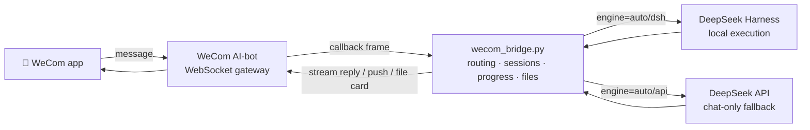

# WeCom Office Assistant

> Control your PC from WeCom (企业微信) on your phone: send one message, let DeepSeek Harness
> execute it on your computer, and get the result (and files) back in the chat.
> Powered by the official WeCom AI-bot WebSocket long connection — **no public IP, no port
> forwarding, no mouse hijacking, no WeChat client automation.**

[](LICENSE)
[](https://www.python.org/)
[](CONTRIBUTING.md)

> 📖 The full documentation is currently in Chinese (primary audience).
> English docs contributions are very welcome — see [CONTRIBUTING.md](CONTRIBUTING.md).

---

## What it does

| You say (in WeCom) | It does |
|---|---|
| "What time is it? Run `date` on the PC." | Executes it on your computer and replies with the output |
| "Summarize the proposal on my desktop into a docx." | Generates the file on the PC and sends it back as a file card |
| "Keep going on yesterday's task…" | Continues with conversation context (per-chat isolation) |
| "Stop" / `/stop` | Cancels the running task immediately |
| `/status` `/help` `/new` | Status, help, new conversation |
| PC off / DSH not running | Falls back to DeepSeek API chat-only mode (optional API key) |

## Architecture



More: [docs/architecture.md](docs/architecture.md) · [docs/workflow.md](docs/workflow.md)

## Features

- **Real execution, not just chat** — drives a locally running DeepSeek Harness desktop app.
- **Automatic fallback** — `engine=auto`: DSH when available, DeepSeek API chat otherwise.
- **No inbound network** — the bridge dials out to WeCom over WSS.
- **Long tasks survive** — progress every 45 s; results switch to active push before the
  WeCom 10-minute streaming limit (errcode 846608); completion notifications.
- **Cancellable** — `/stop` or natural-language "stop" cancels a running task.
- **File delivery** — uploads and sends files (≤50 MB) back to the phone (DSH mode only).
- **Portable** — runs from a USB stick; offline Windows wheels included for Python 3.12.
- **Windows auto-start** — scheduled task + ASCII-only VBS with single-instance guard.
- **Cloud-ready** — systemd unit for an always-on chat-only deployment.
- **Offline self-test** — engine routing, fallback, 401 handling, hot reload, file-exfil guard.

## Quick start (Windows)

```powershell
git clone https://github.com/<your-name>/wecom-office-assistant.git
cd wecom-office-assistant

# initialize environment (or double-click setup.cmd)
python -m venv .venv
.venv\Scripts\activate
pip install -r requirements.txt

# credentials: WeCom admin console -> AI bot -> API mode -> long connection
copy config.example.json config.json
notepad config.json

python wecom_bridge.py      # foreground; or double-click start.cmd
check.cmd                   # self-check: DSH / DeepSeek API
```

Success marker in `logs\bridge.log`:

```text
认证成功，机器人已在线 ✅
```

Full guide: [docs/quickstart.md](docs/quickstart.md) · Workflow: [docs/workflow.md](docs/workflow.md)

## Phone commands

`/status` · `/stop` · `/new` · `/help` · "test notification" · "send me file X"

## Requirements

- WeCom enterprise admin rights (create an AI bot, API mode → long connection)
- Python 3.10+ (3.12 recommended for the bundled offline wheels)
- Optional: DeepSeek Harness desktop app (real PC execution)
- Optional: DeepSeek API key (chat fallback)

## Limitations

- One bot ID allows **one** WebSocket connection — don't run local and cloud at the same time.
- The bridge host must stay online to receive messages; a powered-off PC means offline bot.
- The DSH local API is unofficial and may change with DSH updates.
- `dsh.auto_approve=true` grants remote tasks full access (`danger-full-access`). Read
  [SECURITY.md](SECURITY.md) before enabling in sensitive environments.

## Security

`config.json` contains your bot secret and API key — **never commit or share it**.
The repo ships `config.example.json` only; `.gitignore` excludes secrets, logs, workspace data.
See [SECURITY.md](SECURITY.md) and [docs/security.md](docs/security.md).

## Docs

[Workflow](docs/workflow.md) · [Quick start](docs/quickstart.md) · [WeCom bot setup](docs/wecom-bot-setup.md) ·
[Architecture](docs/architecture.md) · [Configuration](docs/configuration.md) ·
[DSH integration](docs/dsh-integration.md) · [Auto-start](docs/autostart.md) ·
[Cloud deploy](docs/cloud-deploy.md) · [Operations](docs/operations.md) ·
[Troubleshooting](docs/troubleshooting.md) · [FAQ](docs/faq.md) · [Development log](docs/development-log.md)

## License

[MIT](LICENSE) © 2026 The WeCom Office Assistant contributors

Not affiliated with Tencent (WeCom) or DeepSeek. All trademarks belong to their owners.
