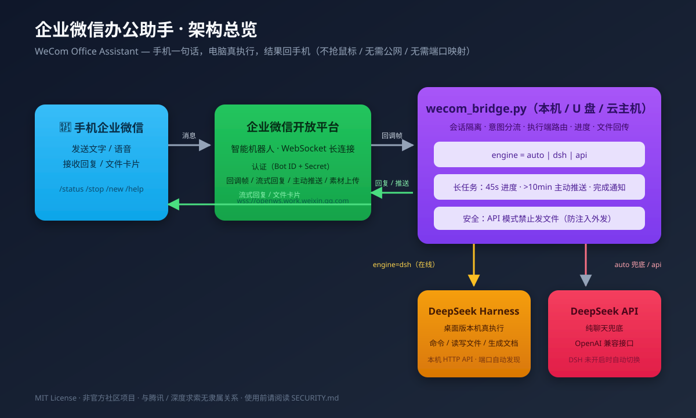
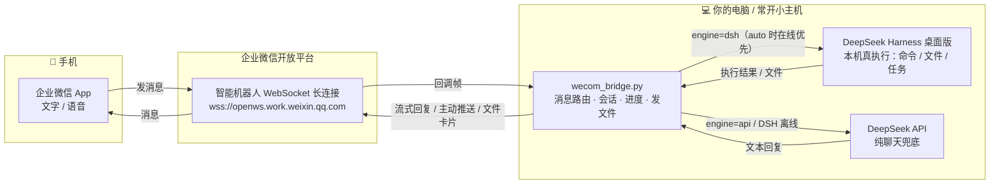

# 企业微信办公助手 · WeCom Office Assistant

> 用手机「企业微信」给机器人发一句话，让它在你的电脑上把活干完，再把结果发回手机。
> 全程走企业微信官方 WebSocket 长连接：**不抢鼠标、不依赖微信客户端、不需要公网 IP、不用端口映射。**

[](LICENSE)
[](https://www.python.org/)
[](#-环境要求)
[](CONTRIBUTING.md)

一个把「聊天软件」变成「电脑遥控器」的桥接程序：手机端是**企业微信智能机器人**，
电脑端是**可插拔的执行引擎**（默认接 DeepSeek Harness 真执行任务，也可只用 DeepSeek API 纯聊天）。

<p align="center">
  
</p>

<p align="center"><b>中文</b> · <a href="README.en.md">English</a></p>

---

## 目录

- [它是什么 / 能做什么](#它是什么--能做什么)
- [架构](#架构)
- [核心特性](#核心特性)
- [环境要求](#环境要求)
- [5 分钟快速开始](#5-分钟快速开始)
- [手机端使用](#手机端使用)
- [三种执行端模式](#三种执行端模式)
- [目录结构](#目录结构)
- [重要限制](#重要限制)
- [安全提醒](#安全提醒)
- [文档导航](#文档导航)
- [开发与自测](#开发与自测)
- [常见问题](#常见问题)
- [许可证](#许可证)

---

## 它是什么 / 能做什么

你在外面（通勤、开会、出差）用手机企业微信给机器人发消息：

| 你说 | 它做 |
|---|---|
| 「用 pwsh 报一下当前时间」 | 在电脑上真的执行命令，把输出发回手机 |
| 「把桌面那个方案整理成一页摘要，存成 docx」 | 在电脑上生成文件，再通过企业微信把文件卡片发到手机 |
| 「电脑上还有多少内存？帮我看看哪个进程占 CPU」 | 读取本机状态并回答 |
| 「接着上次的：跨境电商下一步怎么做」 | 带上历史上下文继续干活（上下文按会话隔离） |
| 「停止」/「/stop」 | 立即中断正在执行的长任务 |
| 「/status」「/help」「/new」 | 查状态、看用法、开新对话 |
| 电脑关机 / DSH 没开 | 自动降级为 DeepSeek API 纯聊天（需要配置 API Key） |

**它不做什么**（有意为之，避免误导）：

- 不能在你电脑关机时操作电脑（企业微信长连接必须有设备常开；云端部署只能纯聊天）。
- 不接管鼠标键盘、不碰微信客户端本身，走的是企业微信官方机器人通道。
- 不会把电脑上的文件随意外发：只有 `engine=dsh` 且模型明确输出文件标记时才会发文件，
  API 模式一律禁止发文件（防提示注入）。

## 架构



> 一条消息的处理流程：收帧 → 解析会话 → 意图分流（停止/状态/帮助/新对话）→ 选择执行端 →
> 发「正在处理…」→ 执行（45 秒一次进度）→ 分片回复（超 10 分钟自动改主动推送）→
> 需要时上传文件并发送文件卡片 → 任务超过 1 分钟额外推送「任务完成」通知。

细节见 [docs/architecture.md](docs/architecture.md) 与 [docs/workflow.md](docs/workflow.md)（完整工作流程）。

## 核心特性

- **真执行，不是聊天机器人**：接本机 DeepSeek Harness，能跑命令、读写文件、生成并回传文件。
- **双执行端自动兜底**：`auto` 模式下 DSH 在线走 DSH，DSH 没开自动切 DeepSeek API 纯聊天，
  切换时手机端会收到一次明确提示（不会假装执行）。
- **长连接免公网**：主动外连企业微信 WebSocket，家庭/公司/任意内网都能用，无需入站端口。
- **长任务不丢结果**：流式消息 10 分钟过期（errcode 846608）时自动改用主动推送；
  每 45 秒刷新进度，超过 1 分钟的任务完成后再推一条完成通知。
- **可中断**：`/stop` 或直接说「停止当前任务」，长任务占锁时也能立即中断（DSH 走 `session/cancel`）。
- **自然语言指令**：语音转文字后同样生效，不需要记命令（「告诉我一下版本号」「停下来吧」）。
- **文件回传手机**：上传临时素材（分片 + md5）后发文件卡片，最大 50MB。
- **会话隔离**：每个聊天/每个用户独立上下文；`/new` 一键换新会话。
- **便携部署**：整个文件夹可放 U 盘，`setup.cmd` 一键建环境；提供 Windows 离线 wheels。
- **开机自启**：Windows 计划任务 + 纯 ASCII VBS 隐藏启动，自带 PID/WMI 单实例保护。
- **可上云**：Linux + systemd 常驻，`engine=api` 纯聊天，电脑关机也能收到回复。
- **离线自测**：`selftest_engine.py` 覆盖引擎路由、API 兜底、401、热加载、防提示注入等 20 项。

## 环境要求

| 项目 | 要求 |
|---|---|
| 企业微信 | 有企业微信管理后台权限（创建「智能机器人」，开启 **API 模式 → 长连接**） |
| 操作系统 | Windows 10/11（完整体验）；Linux（仅 API 纯聊天模式，可云端常驻） |
| Python | 3.10+（推荐 3.12 / 3.13） |
| 可选执行端 | [DeepSeek Harness（DSH）桌面版](https://github.com/deepseek-ai) 已安装并登录（真执行电脑任务） |
| 可选 API | DeepSeek API Key（DSH 没开时的聊天兜底） |

## 5 分钟快速开始

> 详细图文步骤见 [docs/quickstart.md](docs/quickstart.md)；

```powershell
# 1. 获取代码
git clone https://github.com/<你的用户名>/wecom-office-assistant.git
cd wecom-office-assistant

# 2. 初始化运行环境（Windows 双击 setup.cmd 也可以；离线依赖在 wheels\）
python -m venv .venv
.venv\Scripts\activate
pip install -r requirements.txt

# 3. 生成配置并填入 Bot ID / Secret（企业微信管理后台 → 智能机器人 → API 模式）
copy config.example.json config.json
notepad config.json
```

```text
# 4. 启动（二选一）
双击 start.cmd            # 后台运行，日志 logs\bridge.log
python wecom_bridge.py    # 前台运行，调试用

# 5. 自检
双击 check.cmd            # 应看到「DSH：在线 ✅」和/或「DeepSeek API：正常 ✅」
```

手机企业微信里找到这个机器人，发一条「用 pwsh 报一下当前时间」即可。
成功标志：`logs\bridge.log` 里出现 **「认证成功，机器人已在线 ✅」**。

## 手机端使用

| 指令 | 作用 |
|---|---|
| 任意文字 / 语音 | 交给执行端处理；语音由企业微信先转文字 |
| `/status`、`/状态`、「现在什么状态」 | 版本、执行端、DSH 是否在线、当前任务、运行时长 |
| `/stop`、`/停止`、「停止当前任务」「停下来吧」 | 立即中止当前任务 |
| `/new`、「新对话」「重新开始」 | 清空上下文，开新会话 |
| `/help`、`/帮助` | 用法说明 |
| 「帮我加载好办公助手」 | 开机自检口令：返回状态摘要 |
| 「把 XX 文件发我」 | DSH 模式：上传并发送文件卡片到手机 |
| 「测试一下通知」 | 主动推送一条测试通知，验证手机能收到 |

> 长任务会先回「已收到，正在处理…」，每 45 秒刷新进度；超过 1 分钟完成时会额外推送完成通知。

## 三种执行端模式

`config.json → "engine"`：

| 值 | 行为 | 适合谁 |
|---|---|---|
| `auto`（默认） | 先探测本机 DSH：在线用 DSH，离线用 DeepSeek API 纯聊天 | 个人电脑，DSH 开不开都能用 |
| `dsh` | 只用 DSH，不可用就报错（不静默降级） | 只想要电脑真执行 |
| `api` | 只用 DeepSeek API（纯聊天，不执行、不发文件） | 云服务器 / 常开小主机 |

> DSH 在线探测带缓存（在线 60 秒 / 离线 15 秒），不会拖慢每条消息。

## 目录结构

```text
wecom-office-assistant/
├─ wecom_bridge.py          # 主程序：企业微信长连接 + 执行端路由 + 文件回传（单文件，约 2000 行）
├─ selftest_engine.py       # 离线自测（不连企业微信）
├─ config.example.json      # 配置模板（复制为 config.json 后填写）
├─ start.cmd / stop.cmd     # 后台启动 / 停止（Windows）
├─ check.cmd                # 双击自检：DSH + DeepSeek API
├─ run-foreground.cmd       # 前台调试运行
├─ setup.cmd / setup.ps1    # 初始化 / 重建运行环境（离线 wheels 优先）
├─ setup-local-venv.cmd     # 把运行环境建到本地盘（项目在慢速 U 盘时推荐）
├─ set-api-key.cmd / .ps1   # 交互式填写 DeepSeek API Key（不回显、自动备份）
├─ dsh_worker.js            # 备用执行端：DSH SDK-stdio worker（实验性，默认不用）
├─ vendor/dsh-bridge.js     # 备用执行端适配器（实验性，依赖 DSH 未公开协议）
├─ scripts/download-wheels.ps1  # 按当前 Python 版本重新下载离线 wheels
├─ tools/
│  ├─ autostart-hidden.vbs  # 开机自启入口（纯 ASCII，单实例保护）
│  ├─ register-autostart.ps1
│  └─ unregister-autostart.ps1
├─ wheels/                  # Windows 离线依赖（17 个 wheel，~5MB，面向 Python 3.12 x64）
├─ deploy/wecom-bridge.service  # Linux systemd 常驻服务样例
├─ docs/                    # 完整文档（架构 / 快速开始 / 部署 / 排障 / 安全）
└─ .github/workflows/       # CI：语法/配置/自测 + gitleaks 密钥扫描
```

## 重要限制

1. **同一个机器人 ID 只允许一条长连接**。本机与云端同时启动会互相踢下线。
2. **桥接进程所在设备必须常开**才能收消息；电脑关机 = 机器人离线（企业微信机制，代码无法绕过）。
3. 想「电脑关机也能回复」，只能把桥接搬到常开设备（云服务器 / 旧电脑 / NAS），
   且该设备没有 DSH 时只能纯聊天：见 [docs/cloud-deploy.md](docs/cloud-deploy.md)。
4. DSH 真执行依赖本机已安装并登录的 **DeepSeek Harness 桌面版**；DSH 重启后端口会变，
   桥接自动发现，无需改配置。
5. **`dsh.auto_approve=true` 会修改 DSH 默认权限为 `danger-full-access`**（新会话免审批），
   这是为了让无人值守的远程任务能跑通；安全敏感场景请设为 `false`（见 [SECURITY.md](SECURITY.md)）。

## 安全提醒

- `config.json` 含机器人 Secret 与 API Key：**不要提交、不要外发、不要截图**。本仓库已用
  `.gitignore` 排除；提交前请确认 `git status` 没有它。
- 能给你发消息的人 = 能操作你的电脑。请限制机器人可见范围（仅本企业成员），
  不要把机器人开放给不可信成员。
- 如果 Secret / Key 泄露：企业微信后台重置 Secret、DeepSeek 平台删除旧 Key 并重建。
- 更多见 [SECURITY.md](SECURITY.md) 与 [docs/security.md](docs/security.md)。

## 文档导航

| 文档 | 内容 |
|---|---|
| [docs/workflow.md](docs/workflow.md) | **完整工作流程**（从 0 到上线、日常使用、运维、升级） |
| [docs/quickstart.md](docs/quickstart.md) | Windows 快速开始（含企业微信机器人注册） |
| [docs/wecom-bot-setup.md](docs/wecom-bot-setup.md) | 企业微信智能机器人创建与凭证配置 |
| [docs/architecture.md](docs/architecture.md) | 架构、数据流、关键设计决策 |
| [docs/configuration.md](docs/configuration.md) | 配置项逐项说明 |
| [docs/dsh-integration.md](docs/dsh-integration.md) | 与 DeepSeek Harness 的集成方式与限制 |
| [docs/security.md](docs/security.md) | 威胁模型、数据流、加固清单与事件响应 |
| [docs/autostart.md](docs/autostart.md) | Windows 开机自启 / 托盘化 |
| [docs/cloud-deploy.md](docs/cloud-deploy.md) | 云服务器 / 常开小主机部署（纯聊天） |
| [docs/operations.md](docs/operations.md) | 日常运维：日志、自检、会话、文件回传 |
| [docs/troubleshooting.md](docs/troubleshooting.md) | 故障排查（401、846608、审批卡住、端口变化…） |
| [docs/faq.md](docs/faq.md) | 常见问题 |
| [docs/development-log.md](docs/development-log.md) | 开发记录与踩坑（真实经验） |

## 开发与自测

```powershell
python -m py_compile wecom_bridge.py selftest_engine.py
python selftest_engine.py        # 不连企业微信；默认跳过「本机 DSH 在线」假设
$env:WECOM_SELFTEST_DSH="1"; python selftest_engine.py   # 本机 DSH 在线时加测这一项
```

贡献方式见 [CONTRIBUTING.md](CONTRIBUTING.md)；第三方依赖与许可见 [THIRD_PARTY_NOTICES.md](THIRD_PARTY_NOTICES.md)。

## 常见问题

- **手机发了没反应？** 先看 `logs\bridge.log` 最后一行是否「认证成功，机器人已在线」；
  再 `check.cmd` 看执行端是否可用。
- **DSH 开着但机器人说没开？** DSH 刚重启时等十几秒再发；桥接会自动重新发现端口。
- **任务一直「处理中」？** DSH 可能卡在等审批；`/stop` 后可把 `dsh.auto_approve` 打开。
- **超长任务结果没收到？** 代码已自动改主动推送；若仍收不到，可能是该机器人未开通主动推送权限。
- 更多见 [docs/faq.md](docs/faq.md) 与 [docs/troubleshooting.md](docs/troubleshooting.md)。

## 许可证

[MIT](LICENSE) © 2026 The WeCom Office Assistant contributors

> 本项目与腾讯（企业微信）、深度求索（DeepSeek / DeepSeek Harness）无隶属或背书关系；
> 「企业微信」「WeCom」「DeepSeek」「DeepSeek Harness」等商标归各自权利人所有。
