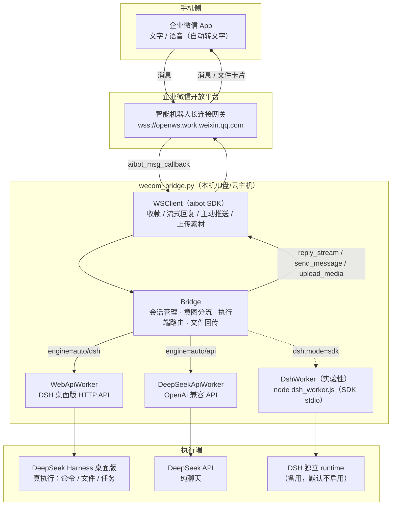
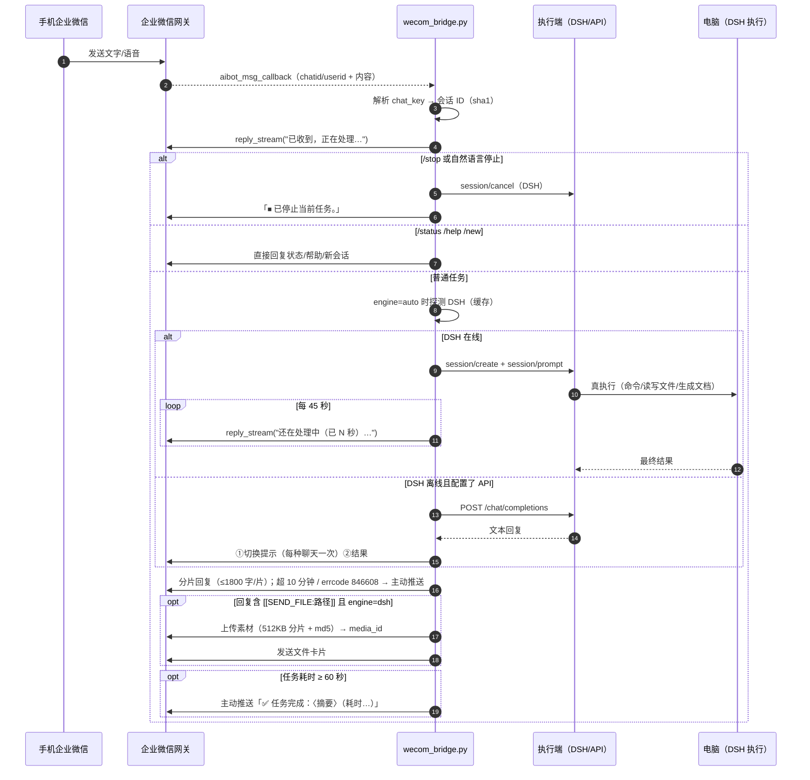

# 架构说明

本文说明「企业微信办公助手」的整体架构、关键模块、数据流与设计取舍。
面向想二次开发或排查问题的读者；只想使用请直接看 [快速开始](quickstart.md)。

---

## 1. 一句话架构

**企业微信智能机器人（WebSocket 长连接） ↔ 本机桥接进程（Python） ↔ 可插拔执行端（DSH 桌面版 / DeepSeek API）。**



---

## 2. 组件职责

| 组件 | 文件 | 职责 |
|---|---|---|
| 接入层 | `WSClient`（官方 `wecom-aibot-python-sdk`） | 建立并保持长连接；收消息回调；流式回复；主动推送；上传临时素材 |
| 业务层 | `Bridge` | 会话隔离、命令识别、排队与锁、进度与超时、错误提示、文件回传、完成通知 |
| 执行端 A | `WebApiWorker` | 发现本机 DSH 端口、鉴权、创建/复用会话、下发任务、轮询结果、取消任务 |
| 执行端 B | `DeepSeekApiWorker` | OpenAI 兼容 `chat/completions`、多轮上下文、Key 热加载、错误中文化 |
| 执行端 C（可选） | `DshWorker` + `dsh_worker.js` + `vendor/dsh-bridge.js` | 用 DSH 独立 runtime 的 SDK stdio 协议执行（实验性，依赖未公开协议） |
| 启动/运维 | `start.cmd` `stop.cmd` `setup.*` `check.cmd` `tools/autostart-hidden.vbs` | 环境初始化、后台启动、单实例、自检、开机自启 |

---

## 3. 一条消息的完整时序



---

## 4. 关键设计决策

### 4.1 执行端错误分级：只有「不可用」才降级

```text
DshUnavailableError  → DSH 没开 / 连不上 / 鉴权失败 → auto 模式可安全降级到 API
DshTaskError         → DSH 已受理但执行失败        → 绝不降级（避免重复执行）
DshTimeoutError      → DSH 已受理但等待超时        → 绝不重试（任务可能仍在电脑上跑）
```

这是整个项目最重要的可靠性设计：**「没接上」可以换路，「接上了但失败/超时」不能偷偷重来**，
否则同一条指令可能在电脑上被执行两遍（例如「删除文件」）。

### 4.2 `engine=auto` 的探测与缓存

- 先 TCP 预检，再发一个极轻的 RPC（`session/modelCatalog`）验证鉴权；
- 在线缓存 `probe_ttl_ok_s`（默认 60s），离线缓存 `probe_ttl_fail_s`（默认 15s），避免每条消息都探测；
- 首次失败且最近 10 分钟连过 → 等 1.5s 重试一次，减少 DSH 繁忙时的误判；
- 探测发生在后台任务里，**不阻塞企业微信上线**（否则 DSH 没开时机器人会连不上）。

### 4.3 DSH 端口自动发现

DSH 桌面版每次启动监听随机端口（实测出现过 57352 / 65151 / 63232 / 57312 等），所以：

1. `tasklist` 找 `DeepSeek Harness.exe` 的 PID；
2. `netstat -ano` 找该 PID 在 `127.0.0.1` 上的 LISTENING 端口；
3. 结果缓存 30 秒；顺序尝试「上次成功地址 → 配置地址 → 自动发现 → 旧默认端口」。

### 4.4 会话隔离

```text
session_id = "wecom-" + sha1(chat_key | session_tag | cwd)[:16]
```

- 每个聊天/每个用户独立会话与上下文；群聊按 chatid 隔离；
- `/new` 加入时间戳 → 换新会话，旧上下文自然丢弃；
- 工作目录参与 hash：换目录自动换会话，避免旧会话把文件写回旧位置；
- API 模式会话 key 追加 `:api`，避免与 DSH 会话混用。

### 4.5 长任务可靠性：流式 + 主动推送双通道

- 企业微信流式消息有 **10 分钟上限**（`errcode 846608`）；
- 每 45 秒刷新一次进度；≥9.5 分钟或遇到 846608 时，结果改走 `send_message` **主动推送**；
- 任务耗时 ≥60 秒，完成后再主动推送一条带指令摘要与耗时的通知；
- 注意：主动推送需要该机器人具备相应权限（管理后台配置）。

### 4.6 文件回传的安全边界

- 模型在 `engine=dsh` 模式下输出 `[[SEND_FILE:绝对路径]]` 才会触发上传；
- 上传走分片接口（512KB/片，≤50MB，md5 校验），成功后发文件卡片；
- **API 模式显式剥离该标记、绝不读取/上传本机文件**，防止提示注入把电脑文件外发。

### 4.7 日志与进程管理

- 日志写入放在**后台线程/队列**：慢速 U 盘偶发卡顿 5~10 秒时不会阻塞 asyncio 事件循环；
- `logs/bridge.pid` 记录真实 Python 子进程 PID（venv 的 pythonw 会有一个启动桩进程）；
- `start.cmd` 用 PID + `tasklist` 判重；自启 VBS 用 PID + WMI 校验命令行含 `wecom_bridge`，
  避免 PID 复用导致误判；`stop.cmd` 用 `taskkill /T /F` 杀整棵进程树。

### 4.8 Windows 脚本编码（血泪教训）

| 类型 | 要求 | 原因 |
|---|---|---|
| `.cmd` | CRLF | LF 批处理在重定向/非交互调用时偶发解析错误 |
| `.ps1` | UTF-8 **with BOM** | Windows PowerShell 5.1 会把无 BOM 的 UTF-8 当 ANSI，中文注释变乱码甚至语法错误 |
| `.vbs` | **纯 ASCII** + CRLF | cscript 按 ANSI 解析，UTF-8 中文会导致「未结束的字符串常量」 |

### 4.9 DSH 权限自动审批（安全披露）

`dsh.auto_approve=true`（默认）时，桥接启动/首次用 DSH 前会调用 DSH 的 `settings/update`，
把默认权限预设设为 `danger-full-access`（新会话免审批）。原因：远程任务没人能在电脑上点「允许」，
否则会卡在 `input-required`。**这等于给远程任务全权限**，不需要的话请设为 `false`。

---

## 5. 部署拓扑

| 拓扑 | 组成 | 能力 | 适用 |
|---|---|---|---|
| **单机（推荐）** | 你的电脑：DSH + 桥接 | 真执行 + 兜底聊天 | 个人办公室电脑、家用电脑 |
| **便携 U 盘** | U 盘放代码/配置/日志，环境可建在本地盘 | 同上 | 公共/临时电脑、多机切换 |
| **常开小主机** | 旧电脑/NAS/迷你主机（无 DSH） | 纯聊天（API） | 想 24 小时在线回复 |
| **云服务器** | Linux + systemd（无 DSH） | 纯聊天（API） | 不想维护硬件 |

> 同一 `bot_id` 只能一条长连接，多拓扑之间必须**切换**（谁在线谁跑），不能同时开。

---

## 6. 如何新增一个执行端（扩展点）

1. 新建 `XxxWorker` 类，实现 `start()` / `stop()` / `ask(session, text, timeout_ms)` / `is_available()`；
2. 在 `Bridge.__init__` 里按 `engine` 配置创建；
3. 在 `_ask_with_fallback` 中接入路由与错误分级：
   - 「不可用」类错误可以降级；
   - 「已受理但失败/超时」类错误必须原样报给手机；
4. 不要执行任何未经用户明确要求的本机文件外发操作。

---

## 7. 已知边界

- DSH 的 HTTP API 与 SDK stdio 协议**未公开**，升级 DSH 后可能变化（web 模式影响小，sdk 模式影响大）。
- 桥接的所有能力都建立在「机器人凭证可信」之上，凭证泄露 = 控制权泄露。
- 企业微信流式消息 10 分钟上限、主动推送权限、单长连接限制，均为平台侧硬约束。
