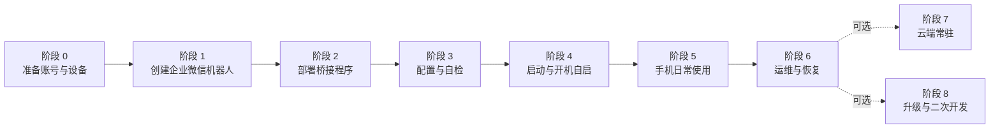

# 完整工作流程（从 0 到日常使用）

> 这是本项目的主文档：把「注册机器人 → 部署桥接 → 手机使用 → 开机自启 → 云端常驻 → 排障升级」
> 整条链路一次讲清。第一次部署请按顺序做；日常使用只看第 5、6 节即可。



---

## 阶段 0 · 准备（约 5 分钟）

| 项目 | 说明 | 检查 |
|---|---|---|
| 企业微信 | 有管理员权限（至少能创建应用/机器人） | 手机能登录企业微信 |
| 电脑 | Windows 10/11；能装 Python 3.10+ | `python --version` |
| 网络 | 能访问 `openws.work.weixin.qq.com:443`（出站即可） | 浏览器能打开企业微信官网 |
| 真执行（可选） | 安装并登录 DeepSeek Harness（DSH）桌面版 | DSH 界面能正常对话 |
| API 兜底（可选） | DeepSeek 开放平台账号，创建 API Key | 有 `sk-` 开头的 Key |

> **只想纯聊天**：可以不装 DSH，但仍需要一台常开设备跑桥接。
> **想操作电脑**：DSH 必须在这台电脑上安装并登录。

---

## 阶段 1 · 创建企业微信智能机器人（约 10 分钟）

1. 电脑浏览器登录 [企业微信管理后台](https://work.weixin.qq.com/)；
2. 进入 **应用管理 → 智能机器人**（不同版本入口可能略有差异，以官方文档为准）；
3. **创建机器人**：填名称、头像、可见范围（建议先只给自己/小范围）；
4. 进入机器人详情 → **开启「API 模式」，连接方式选择「长连接」**；
5. 复制并保存两个凭证：
   - **Bot ID**：机器人唯一标识；
   - **Secret**：长连接专用密钥（等同机器人密码）。
6. （可选）确认机器人已开启消息接收 / 主动推送权限（若要用「任务完成通知」「长时间任务结果推送」）。

官方参考：
- 企业微信开发者中心 · 智能机器人概述：<https://developer.work.weixin.qq.com/document/path/101833>
- 开发前必读（创建机器人 / 获取凭证）：<https://developer.work.weixin.qq.com/document/path/101805>
- 长连接协议说明：<https://developer.work.weixin.qq.com/document/path/101463>
- 接收消息回调：<https://developer.work.weixin.qq.com/document/path/101834>
- 官方 Python SDK：<https://github.com/WecomTeam/wecom-aibot-python-sdk>

> 详细图文步骤见 [wecom-bot-setup.md](wecom-bot-setup.md)。
> **不要把 Bot ID / Secret 发到聊天、截图或提交到 Git。**

✅ 检查点：手里有 Bot ID 和 Secret，且机器人详情页显示「长连接 / API 模式」已开启。

---

## 阶段 2 · 部署桥接程序（约 5 分钟）

### 2.1 拿到代码

```powershell
git clone https://github.com/<你的用户名>/wecom-office-assistant.git
cd wecom-office-assistant
```

> 没有 Git 也可以：GitHub 页面 → Code → Download ZIP → 解压到任意目录（**不要放只读目录**）。

### 2.2 初始化运行环境

**Windows（推荐，双击即可）：**

```text
双击 setup.cmd            # 默认在项目内创建 .venv，优先用 wheels\ 离线安装
```

如果项目放在**读写很慢的 U 盘/移动硬盘**，建议把环境放本地盘：

```text
双击 setup-local-venv.cmd # 等价于 setup.ps1 -VenvDir C:\wecom-venv
```

**命令行方式：**

```powershell
python -m venv .venv
.venv\Scripts\activate
pip install -r requirements.txt          # 在线
# 或离线：
pip install --no-index --find-links=wheels -r requirements.txt
```

**Linux（云端纯聊天）：**

```bash
sudo apt update && sudo apt install -y python3 python3-venv python3-pip
cd wecom-office-assistant
python3 -m venv .venv
.venv/bin/pip install -r requirements.txt
```

### 2.3 填配置

```powershell
copy config.example.json config.json
notepad config.json
```

至少填：

```json
{
  "bot_id": "你的 Bot ID",
  "bot_secret": "你的 Secret",
  "engine": "auto"
}
```

API Key 二选一（推荐环境变量，不落盘）：

```powershell
# 方式 A：交互式写入 config.json（不回显、自动备份）
双击 set-api-key.cmd

# 方式 B：环境变量（当前会话生效）
$env:DEEPSEEK_API_KEY = "sk-你的Key"
```

> 配置项完整说明见 [configuration.md](configuration.md)。

✅ 检查点：`config.json` 存在、`bot_id`/`bot_secret` 已填；`python -m py_compile wecom_bridge.py` 无报错。

---

## 阶段 3 · 自检（2 分钟）

```text
双击 check.cmd
```

正常输出示例：

```text
[自检] 引擎模式：auto
[自检] DSH：在线 ✅（http://127.0.0.1:57312）
[自检] DeepSeek API：正常 ✅ 模型 deepseek-chat，回复：在线
[自检] 结论：本机现在发消息会由 —— DSH（自动检测：在线，优先用 DSH）
[自检] 完成 ✅
```

| 结果 | 含义 | 下一步 |
|---|---|---|
| DSH 在线 ✅ | 发消息会真执行电脑任务 | 直接进入阶段 4 |
| DSH 未开启 + API 正常 ✅ | 发消息会纯聊天 | 想真执行就启动/登录 DSH |
| 两个都不可用 | 发消息会报错 | 看 [troubleshooting.md](troubleshooting.md) |

---

## 阶段 4 · 启动与开机自启

### 4.1 启动

```text
双击 start.cmd          # 后台运行（Windows）
```

看日志 `logs\bridge.log`，出现下面这行即成功：

```text
认证成功，机器人已在线 ✅（在手机企业微信里给它发消息即可）
```

停止：`stop.cmd`（离开电脑/拔 U 盘前务必先停）。

### 4.2 开机自启（Windows，推荐）

**第一步：注册计划任务**（管理员 PowerShell）：

```powershell
powershell -ExecutionPolicy Bypass -File tools\register-autostart.ps1
```

脚本会创建计划任务 `WeComOfficeAssistant-Autostart`（登录 Windows 时触发），
动作是 `wscript.exe //nologo <项目>\tools\autostart-hidden.vbs`。

**第二步：验证**

```powershell
schtasks /Query /TN "WeComOfficeAssistant-Autostart" /V /FO LIST
schtasks /Run   /TN "WeComOfficeAssistant-Autostart"
```

- 启动成功：`logs\autostart.log` 出现 `started hidden: ...`；
- 已在运行：出现 `already running ... skip start (no duplicate)`（单实例保护，正常）；
- 自启失败：看 `docs/autostart.md` 的排查表。

> 换盘符 / 移动项目目录后：VBS 能自适应，但计划任务里的路径是绝对路径，需要重新运行一次注册脚本。

✅ 检查点：重启电脑 → 登录后 30~60 秒 → 手机发 `/status` 有回复。

---

## 阶段 5 · 手机日常使用

### 5.1 基本对话

在手机企业微信里找到机器人（默认可见范围里的成员可见），直接发文字或语音。

- 首次进入会话会收到欢迎语与能力说明；
- 机器人先回「已收到，正在处理…」，完成后回结果；
- 长任务每 45 秒刷新进度；
- 任务超过 1 分钟完成，会额外推一条「✅ 任务完成：〈摘要〉（耗时 X 分 Y 秒）」。

### 5.2 常用指令

| 你说 | 效果 |
|---|---|
| `/status`、「现在什么状态」 | 版本、执行端、DSH 地址、当前任务、运行时长 |
| `/stop`、「停止」「停止当前任务」「停下来吧」 | 立即中断当前任务（长任务占锁也能停） |
| `/new`、「新对话」「重新开始」 | 清空上下文，开新会话 |
| `/help` | 用法说明 |
| 「帮我加载好办公助手」 | 状态自检口令 |
| 「测试一下通知」 | 主动推送一条测试通知 |
| 「把 XX 文件发我」 | DSH 模式：上传并发送文件卡片（≤50MB） |

### 5.3 让它真干活（DSH 模式）

- 明确说清目标、路径、输出格式，例如：
  「在电脑上把 `D:\项目\需求.docx` 整理成一页摘要，存成 `D:\项目\摘要.docx`，然后把摘要发我」；
- 任务会长：跑命令、读写文件由 DSH 在电脑上执行，手机侧只需等结果；
- DSH 的审批策略：默认桥接会把新会话设为免审批（`danger-full-access`），
  若你改成 `dsh.auto_approve=false`，任务可能卡在「等待电脑上批准」，需要人到电脑前点允许。

### 5.4 纯聊天兜底（DSH 没开）

- 手机端会先收到一条提示：「⚠️ 电脑端 DSH 没开，本条由 DeepSeek API 直接回复（只能聊天…）」；
- 该提示**每种聊天只出现一次**，之后正常聊天；
- API 模式不会执行命令、不会发文件（安全设计）。

---

## 阶段 6 · 运维、备份与恢复

### 6.1 每天/每次上机检查（30 秒）

1. `check.cmd` → 两个执行端至少一个 ✅；
2. `logs\bridge.log` 最后几行是否有错误；
3. 手机发 `/status` 验证链路。

### 6.2 日志位置

| 文件 | 内容 |
|---|---|
| `logs\bridge.log` | 启动、探测、执行端选择、结果摘要、错误堆栈 |
| `logs\autostart.log` | 开机自启过程（begin / pythonw / pid / started / skip / ERROR） |
| `logs\bridge.pid` | 当前真实进程 PID |

> 日志会在本地保存聊天内容摘要，**分享日志前请脱敏**（机器人 Secret、API Key 代码已自动掩码）。

### 6.3 备份建议

- 必备份：`config.json`（**离线/加密保存**）、`workspace\` 里的产出、`docs\` 与代码；
- 不要备份：`.venv\`、`logs\`（可重建，且可能含隐私）、`__pycache__\`；
- 代码用 Git 托管；配置与密钥用密码管理器/离线介质单独保管。

### 6.4 重启 / C 盘还原 / 换电脑后恢复

**只重启电脑（环境还在）：**

1. 等 30~60 秒，检查 `logs\bridge.log` 是否有「认证成功」；
2. 没有就运行一次 `start.cmd`。

**C 盘被还原 / 换了一台电脑：**

```text
1) 双击 setup.cmd（或 setup-local-venv.cmd）重建运行环境
2) 填 config.json（如果丢失：从备份恢复；Bot 凭证不用重新注册）
3) 双击 check.cmd 确认执行端
4) 双击 start.cmd 启动
5) 重新注册开机自启（计划任务路径可能失效）
```

**U 盘盘符变了：**

- 桥接与 VBS 都是相对路径，程序本身不受影响；
- 计划任务里的 VBS 路径是绝对路径 → 重新运行 `tools\register-autostart.ps1`。

### 6.5 密钥轮换

1. 企业微信后台重置机器人 Secret；
2. DeepSeek 平台删除旧 API Key、创建新 Key；
3. 更新 `config.json`（或用环境变量）→ 重启桥接（API Key 会热加载，Secret 需要重启）。

### 6.6 卸载

```text
1) 双击 stop.cmd
2) schtasks /Delete /TN "WeComOfficeAssistant-Autostart" /F
3) 删除项目文件夹
4) （可选）企业微信后台删除机器人；DeepSeek 平台删除 API Key
```

---

## 阶段 7 · 可选：云端常驻（电脑关机也能收到回复）

> 前提：**云端只能纯聊天**（没有你电脑上的 DSH，无法操作电脑）。
> 好处：电脑关机/不在线时，手机至少能聊天、问问题、让它记事情。

1. 买/找一台常开设备：轻量云服务器（2 核 2G 足够）、旧电脑、NAS、迷你主机；
2. 按 [cloud-deploy.md](cloud-deploy.md) 部署：Python 环境 → 项目 → `engine=api` → systemd 常驻；
3. 注意 **同一个机器人 ID 只能一条长连接**：云端和本地**必须二选一**；
4. 切换方式（谁在线谁跑）：

```text
不在电脑前/电脑关机：云端 systemctl start → 手机纯聊天
到电脑前要真执行：云端 systemctl stop → 本地 start.cmd
离开电脑：本地 stop.cmd → 云端 systemctl start
```

---

## 阶段 8 · 升级与二次开发

### 8.1 升级

```powershell
git pull
# 如果依赖有变化：
.venv\Scripts\pip install -r requirements.txt
# 重启
stop.cmd
start.cmd
check.cmd
```

> 升级前先备份 `config.json`（脚本升级不会动它，但备份永远是对的）。

### 8.2 二次开发

- 入口：`wecom_bridge.py`（单文件，分层清晰）；配置项见 [configuration.md](configuration.md)；
- 新增执行端：见 [architecture.md](architecture.md) 第 6 节；
- 开发约定与编码坑：见 [CONTRIBUTING.md](../CONTRIBUTING.md)；
- 离线自测：`python selftest_engine.py`（默认跳过「本机 DSH 在线」假设）。

### 8.3 开发证据留存（可选，软件著作权登记用）

如果后续要申请软件著作权，建议从第一天开始留证据：

- Git 提交历史（带时间戳）与仓库地址；
- 每个版本的 `CHANGELOG.md`、设计文档、自测报告；
- 关键功能截图/录屏（手机端对话、电脑端执行、日志）；
- 代码行数与源文件清单（`git ls-files | xargs sha256sum` 可生成）；
- 开发过程记录：[development-log.md](development-log.md)。

---

## 附：上线检查清单（Checklist）

```text
[ ] 企业微信机器人已创建，API 模式 = 长连接，拿到 Bot ID / Secret
[ ] Python 3.10+ 已安装；项目依赖已装（setup.cmd 或 pip）
[ ] config.json 已填写，且没有把密钥提交到 Git
[ ] check.cmd 至少一个执行端 ✅
[ ] start.cmd 启动后日志出现「认证成功，机器人已在线」
[ ] 手机发 /status 有回复；发「用 pwsh 报一下当前时间」能真执行（DSH 模式）
[ ] /stop 能中断长任务；「测试一下通知」能收到主动推送
[ ] 开机自启已注册并实测（可选但推荐）
[ ] 离开电脑前 stop.cmd；长期不用时注销计划任务
[ ] config.json / API Key 已离线备份
```

---

## 附：一页速查（贴墙版）

```text
启动：start.cmd          停止：stop.cmd        自检：check.cmd
日志：logs\bridge.log    自启日志：logs\autostart.log
成功标志：认证成功，机器人已在线 ✅
手机：/status  /stop  /new  /help
DSH 没开：自动 DeepSeek API 纯聊天（需 API Key）
硬限制：一个机器人一条长连接；电脑关机机器人离线
出事顺序：看日志 → check.cmd → docs\troubleshooting.md
```
